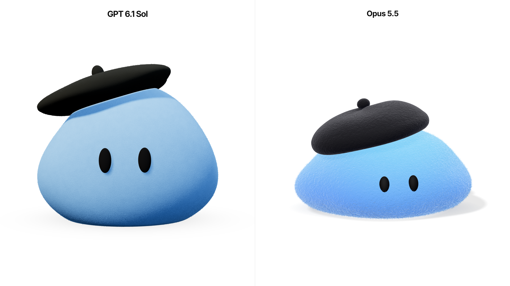

# GPT 6.1 Sol vs Opus 5.5: same prompt, same reference, two 3D characters

Two AI models were given **the same prompt** and **the same reference image** and asked to build an interactive, animated 3D character that renders live in the browser with Three.js. They got no starter code, and neither model saw the other's work.



🎬 **Video:** [`media/side-by-side.mp4`](media/side-by-side.mp4). Both apps run side by side and receive the same scripted pointer path: idle, slow sweep, circle, fast shake, click, then the cursor leaves.

## The task

The target was a Dots-style felt blob: a soft, slightly irregular light-blue body, a fuzzy felt surface, two black oval eyes and a tilted black beret. It has no mouth and no limbs. The full, unedited prompt is in **[PROMPT.md](PROMPT.md)** and the reference image is in [`references/dots-reference.png`](references/dots-reference.png).

Summary of the requirements:

- live WebGL rendering with Three.js (no video, GIF, sprites or pre-rendered frames)
- procedural geometry and shaders; no textures or 3D models from files
- idle animation: breathing, squash and stretch, wobble, blinking, glances, a "curious" behaviour and delayed beret motion, all run by a small state machine
- a subtle reaction to the mouse, with a smooth return to neutral
- responsive canvas, capped pixel ratio, a 60 FPS target
- follow-up message: white background, the model name at the top in Inter Bold, and more animation driven by mouse movement

## Rules of the comparison

- Same prompt text and same reference image for both models. The only difference was the name in the heading.
- One implementation per model, built in its own folder.
- Opus 5.5 was told explicitly not to look at or copy the GPT code.
- The code in this repo is exactly what each model produced. I did not edit it by hand. Each model's own notes are in its folder's README.

## Results at a glance

|                         | [GPT 6.1 Sol](gpt-6.1-sol/)                                  | [Opus 5.5](opus-5.5/)                                                        |
| ----------------------- | ------------------------------------------------------------ | ---------------------------------------------------------------------------- |
| Source files (`src/`)   | 16                                                           | 23                                                                           |
| Non-blank lines of code | ~550                                                         | ~1,330                                                                       |
| JS bundle (gzip)        | ~136 kB                                                      | ~145 kB                                                                      |
| Runtime dependencies    | `three`, `@fontsource/inter`                                 | `three`, `@fontsource/inter`                                                 |
| Felt technique          | custom noise, normal and fresnel on a rough material, plus ~19k short fiber meshes | `MeshPhysicalMaterial` + sheen with injected GLSL noise and bump, plus 3 shell-fur layers |
| Body deformation        | deformed sphere, spring-based squash and stretch             | deformed sphere, vertex-shader shear and ripple, CPU mirror so the eyes and beret stay attached |
| Mouse reaction          | eye direction, body lean, sway and compression from speed    | eye direction, lean, sway from speed, a jolt on fast jerks, squash on click or touch |

Most of the bundle is Three.js itself. The line counts include GLSL.

## Run it yourself

You need Node.js 22.12+ (required by Vite 8) and a browser with WebGL.

```sh
git clone https://github.com/<your-username>/felt-dot-gpt-vs-opus.git
cd felt-dot-gpt-vs-opus

# GPT 6.1 Sol → http://localhost:5173
cd gpt-6.1-sol && npm install && npm run dev

# Opus 5.5 → http://localhost:5174 (in a second terminal)
cd opus-5.5 && npm install && npm run dev
```

The two apps use different ports, so both can run at once. For a fair comparison, use the same browser, the same window size and similar mouse movement. Run `npm run build && npm run preview` for a production build.

## What to compare

- **Likeness to the reference:** silhouette, proportions, eyes, beret, felt texture
- **Animation:** how natural the breathing, blinking, deformation and beret lag feel
- **Interaction:** how well the character responds to the cursor and settles back
- **Mobile:** layout and framing on a phone-sized screen
- **Code:** structure, readability and how easy it is to reuse

## Repository layout

```text
.
├── gpt-6.1-sol/          # implementation by GPT 6.1 Sol (Vite + TypeScript + Three.js)
├── opus-5.5/             # implementation by Opus 5.5 (Vite + TypeScript + Three.js)
├── references/
│   └── dots-reference.png
├── media/                # screenshots and a side-by-side video captured from these builds
├── PROMPT.md             # the exact prompt given to both models
└── README.md
```

## Notes

- The screenshots and the video were captured automatically in headless Chrome from the production builds in this repo. They show a single moment of a live, randomised animation, so your run will look slightly different.
- The reference image comes from OpenAI's "Dots" characters. It is included only as the shared visual brief. This project is not affiliated with OpenAI or Anthropic.
