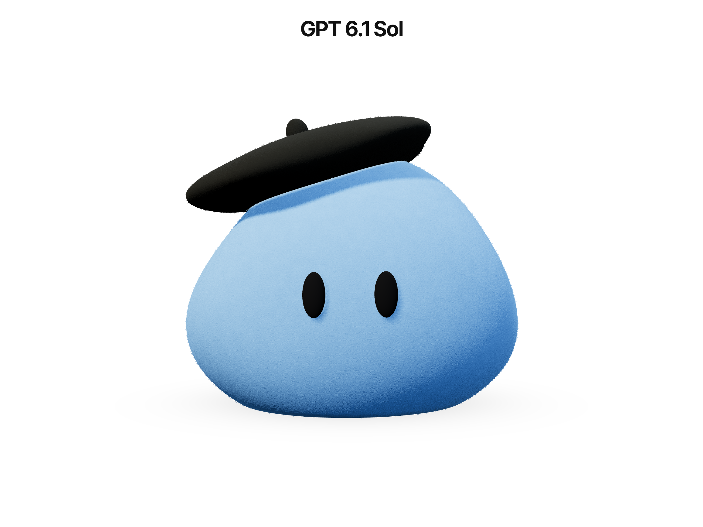

# Felt Dot

Implementation by GPT 6.1 Sol. See the [comparison README](../README.md), [full prompt](../PROMPT.md), and [shared reference image](../references/dots-reference.png).

A live, procedural Three.js character based on the supplied blue blob reference, on a white background with an Inter Bold heading. No external models, textures, videos, sprites, or postprocessing. Three.js handles rendering; the Inter font is bundled locally through Fontsource.



## Run

```sh
cd gpt-6.1-sol
npm install
npm run dev
```

Open the local URL printed by Vite. `npm run build` checks TypeScript and produces `dist/`; `npm run preview` serves that build. Use Node.js 22.12+ or a compatible newer version supported by Vite.

## Tune and reuse

Defaults live in `src/dot/config.ts`. The body and beret use deformed sphere geometry, a custom noise/normal/fresnel extension to a rough Three.js material, and two small opaque fiber meshes. The eye mounts follow the body and blink independently of the motion state machine. Curiosity, glances, breathing, spring settling, pointer response, and damped beret motion are composed in `DotAnimator`.

```ts
import { createDotExperience } from './src/createDotExperience';

const experience = createDotExperience(container, {
  bodyColor: '#77B7FF',
  mouseFollowStrength: 0.13,
  mouseMotionStrength: 0.035,
});

// When unmounting the page or component:
experience.dispose();
```

Give the container an explicit width and height. Its canvas resizes through `ResizeObserver`, including camera framing in portrait layouts. Device pixel ratio is capped at 2. Hidden tabs pause rendering; reduced-motion preferences attenuate the idle motion and disable curiosity. Pointer position drives the eyes and body lean; faster movement adds a short sway and soft compression, with delayed beret motion. Touch release and pointer exit return the character to neutral.

For tighter mobile GPU budgets, reduce `fiberCount` to 7000 and `maxPixelRatio` to 1.5. No fixed hardware FPS guarantee is assumed.

Implementation references: [Three.js materials](https://threejs.org/docs/pages/MeshStandardMaterial.html), [material shader hooks](https://threejs.org/docs/pages/Material.html), [WebGL renderer](https://threejs.org/docs/pages/WebGLRenderer.html), [Vite setup](https://vite.dev/guide/).
