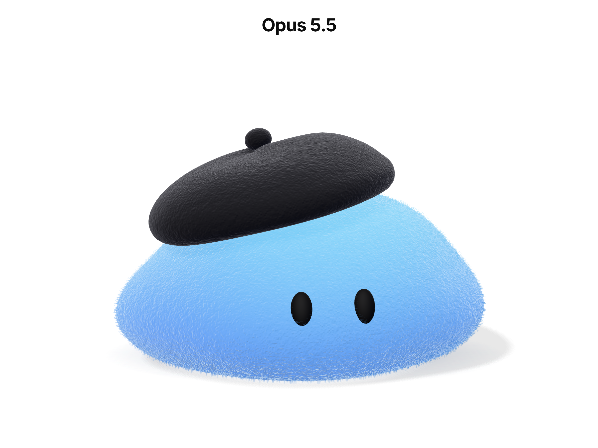

# Opus 5.5

Implementation by Opus 5.5. See the [comparison README](../README.md), the [full prompt](../PROMPT.md) and the [shared reference image](../references/dots-reference.png).

An interactive, animated Dots-style 3D character, rendered live with Three.js. Following the prompt's follow-up message, the page has a white background, an **Opus 5.5** heading in Inter Bold, and the character reacts to both the position and the movement of the mouse.



## Run

You need Node.js 22.12+ (required by Vite 8) and a browser with WebGL2.

```sh
cd opus-5.5
npm install
npm run dev        # http://localhost:5174
```

For a production build, run `npm run build`, then `npm run preview` (port 4174). These ports differ from the GPT version's, so both servers can run at the same time.

## Structure

```text
src/
  main.ts                    # font, styles, mounting
  createDotExperience.ts     # renderer, loop, resize, dispose; embeddable in any page
  config.ts                  # DOT_CONFIG: every tunable parameter in one place
  scene/
    createScene.ts           # renderer, white background, studio environment, shadow-catcher floor
    createLights.ts          # key (upper-left, front), fill, rim, hemisphere
    createCamera.ts          # static camera that adapts its framing to the aspect ratio
  dot/
    createDot.ts             # assembles the character and a soft contact shadow
    createBody.ts            # procedural body and fur shells
    createEyes.ts            # two black ovals seated on the surface
    createBeret.ts           # beret from LatheGeometry, plus the stem
    feltMaterial.ts          # felt material (GLSL injected into MeshPhysicalMaterial)
    deform.ts                # CPU mirror of the shader deformation
    DotAnimator.ts           # state machine, blinking, springs, pointer reaction
  interaction/
    PointerTracker.ts        # pointer/touch position and smoothed velocity
  shaders/
    feltVertex.glsl, feltFragment.glsl, deform.glsl, noise.glsl,
    furShell.vert.glsl, furShell.frag.glsl, chunks.ts
  utils/math.ts              # damp, smoothstep, easing, Spring
```

The only runtime dependencies are `three` and `@fontsource/inter`, and the font is bundled locally. There is no React, no game engine, no post-processing, and no texture or model files.

## Approach

**Body.** It starts from a `SphereGeometry` (160×120) and deforms every vertex. A few Gaussian "lobes" give a cloud-like, slightly asymmetric outline with the largest bulge on the left. The bottom is wider and the top narrower. A polynomial smooth-max flattens the base, so the character looks like it is settling under its own weight. The eyes and the beret are placed by raycasting onto the finished surface, so they always sit flush with it.

**Felt.** The base is `MeshPhysicalMaterial` with roughness 0.95 and a `sheen` layer. `onBeforeCompile` adds four things:

- 3D procedural noise that varies the fibre colour
- a screen-space bump, computed without textures
- a gradient from deeper blue at the bottom to lighter cyan at the top
- a fresnel haze on the edges

Three translucent shell-fur layers on top give the silhouette its soft, fuzzy look. The beret uses the same material in black.

**Real-time deformation.** Leaning works as a shear in the vertex shader: the base stays on the floor while the top tilts. Sudden movements add a gentle ripple. Normals are corrected analytically. The same deformation runs in the shadow pass, and `deform.ts` mirrors it on the CPU so the eyes and beret follow the surface.

**Animation (`DotAnimator`).** The main state machine cycles `IDLE → LOOK_LEFT / LOOK_RIGHT → RETURN_TO_IDLE`, with `CURIOUS` every 8–15 s.

- **Curious:** the eyes move first, then the body slowly leans and stretches, pauses and blinks, then returns smoothly. `RETURN_TO_IDLE` fades out the last pose on a sine curve.
- **Blinking:** a separate layer (`OPEN / BLINK`). Blinks come every 3–6 s and last 150 ms, with scaleY going 1 → 0.05 → 1 and a ~22% chance of a double blink.
- **Breathing and wobble:** breathing changes scale by about ±1.5% while preserving volume. Wobble is layered sines around X and Z.
- **Squash, stretch and lean:** these run on springs, so movement overshoots slightly and then settles.
- **Beret:** it has its own, less damped springs, so it lags, overshoots a little and settles back.
- **Eyes:** each eye has its own micro-movement.

**Mouse and touch.** The character reacts to both where the cursor is and how it moves:

- **Position:** the eyes follow the cursor, and the body turns and leans slightly towards it.
- **Velocity:** fast horizontal movement makes the body sway in that direction. Vertical movement gently stretches or squashes it.
- **Sharp jerk:** the character hops, its eyes widen and the beret kicks. It usually blinks once things settle.
- **Click or tap:** the body squashes, then bounces back and blinks on release.
- **Cursor leaves the canvas or stops moving:** the character eases back into its own idle behaviour. `CURIOUS` does not trigger during interaction.

With `prefers-reduced-motion`, motion amplitudes are reduced.

## Configuration

All parameters are in [src/config.ts](src/config.ts) (`DOT_CONFIG`): colours, roughness, fuzz and bump strength, fur shell count and length, breathing, wobble, gaze range, blink and behaviour timing, beret springs, `mouseFollowStrength`, `mouseMotionStrength` and shadows. You can also override them when embedding:

```ts
import { createDotExperience } from "./createDotExperience";

const dot = createDotExperience(document.querySelector("#hero")!, { mouseFollowStrength: 0.05 });
dot.animator.triggerCurious(-1);
// call dot.dispose() on unmount
```

## Checks performed

- `npm run build` (`tsc --noEmit` + `vite build`) passes with no type errors.
- Browser preview at 1280×800 and at the iPhone 12 Pro preset (390×844): the full character, beret and heading fit in the frame.
- Stepping the animator with a fixed `dt` confirmed the following:
  - the eyes follow the cursor and the body leans towards it
  - a click squashes the body and release bounces it back
  - leaving the canvas returns the character to neutral
  - the `CURIOUS` phases run in the right order and return smoothly
  - blinking happens about 18 times per minute
- Animation logic costs about 0.02 ms of CPU per frame. GPU cost was not measured because the background preview was throttled to about 2 fps, so 60 FPS still needs checking in a normal browser.
